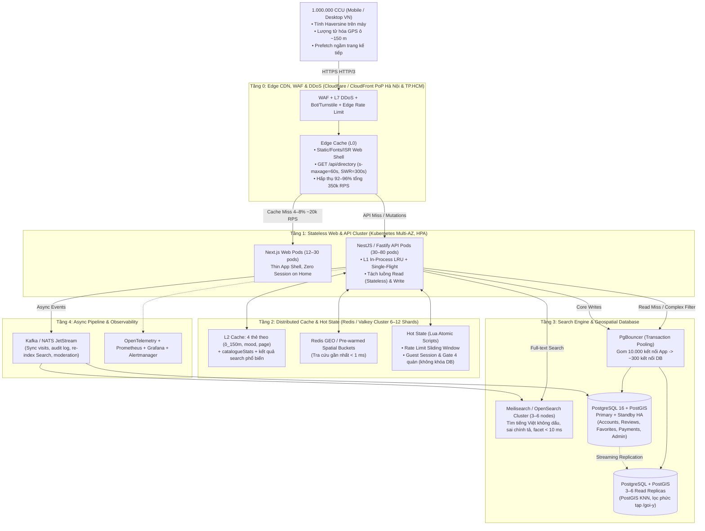

# Kiến trúc Hệ thống Chịu tải 1.000.000 CCU — Tìm quán ngon (`timquanngon.com`)

Tài liệu thiết kế kiến trúc hệ thống chịu tải đến **1.000.000 người dùng đồng thời (1M CCU)** cho ứng dụng **Tìm quán ngon** (`timquanngon.com`, ưu tiên trải nghiệm chọn 4 thẻ món ăn trong < 50 ms trên di động tại Việt Nam).

---

## 1. Phân tích tải & Bài toán dung lượng (Capacity Planning)

Đặc thù ngành ẩm thực tại Việt Nam có **đỉnh tải cực nhọn (bursty traffic)** vào khung giờ cao điểm **11:15–12:30 (ăn trưa)** và **18:00–19:45 (ăn tối)**:

| Chỉ số | Quy mô mục tiêu (1M CCU) | Cơ sở ước tính |
| --- | --- | --- |
| **Concurrent Users (CCU)** | **1.000.000** | Người dùng đang mở web/tương tác trong cùng cửa sổ 1–2 phút |
| **Steady Peak RPS** | **80.000 – 120.000 RPS** | Trung bình 1 user tạo ~6–8 request/phút (load trang + 4 lần đổi thẻ + 1 tìm kiếm/ghé thăm) |
| **Flash Spike RPS (11:45 trưa / viral)** | **250.000 – 350.000 RPS** | Hệ số đỉnh 3× trong 2–5 phút cao điểm |
| **Tỷ lệ Đọc / Ghi (Read : Write)** | **97% Đọc : 3% Ghi** | ~340.000 Read RPS (`GET /`, `/api/directory`, `/api/restaurants`) vs ~10.000 Write RPS (`POST /visit`, `/auth`, `/favorite`, `/reviews`) |
| **Kích thước phản hồi 4 thẻ (Gzip/Brotli)** | **~1.2 KB** | Thuần chữ (text-only), không ảnh -> tiết kiệm 95% băng thông so với web có ảnh |
| **Băng thông ra (Egress Peak)** | **~3.4 Gbps** | `350.000 RPS × 1.2 KB × 8 bit` — hoàn toàn nằm gọn trong tầng Edge CDN |
| **Mục tiêu độ trễ (SLO)** | **p50 < 20 ms · p95 < 50 ms (Edge)** / **p95 < 120 ms (Origin)** | Tỷ lệ lỗi `< 0.1%`, SLA `99.95%` |

---

## 2. Tại sao kiến trúc MVP ban đầu sập ở ~500 CCU? (Và những gì đã xử lý ngay trong mã nguồn)

1. **Ghi DB trên mọi request đọc (`sessions` + `rate_limits`):** Trước khi tối ưu, mỗi `GET /api/directory` đều ghi 2 lệnh `INSERT/UPDATE` vào PostgreSQL và gắn `Set-Cookie` + `Cache-Control: no-store`. -> **Đã khắc phục:** Tách hoàn toàn luồng đọc công khai thành **stateless (0 DB write, không Set-Cookie)**, dùng `credentials: 'omit'` trên client và bật `Cache-Control: public, s-maxage=60, stale-while-revalidate=300`.
2. **Full-table `ST_Distance` + Window Sort trên 71.826 dòng:** Hàm `fourSuggestions()` cũ tính khoảng cách và sort toàn bảng cho mỗi lượt gọi. -> **Đã khắc phục:** Chuyển sang toán tử **PostGIS GiST KNN (`<->`)** có giới hạn ứng viên + kiểm tra tính chính xác (exactness guard) + fallback `CROSS JOIN LATERAL` qua composite index `(primary_group, location)` (Migration `008`).
3. **JOIN View `review_aggregates` & subquery `prior` mỗi lần tìm:** -> **Đã khắc phục:** Materialize `review_count`, `review_avg` trực tiếp trên bảng `restaurants` bằng trigger nguyên tử, cache Bayesian `prior` kèm single-flight.
4. **Nạp 71.826 quán vào RAM Node.js ở `/locations/resolve` và `/admin`:** -> **Đã khắc phục:** Đẩy xuống truy vấn SQL có chỉ mục và phân trang `LIMIT`.
5. **Không có bộ đệm theo ô không gian & chống thundering herd:** -> **Đã khắc phục:** Lượng tử hóa tọa độ theo ô lưới **~150 m (`quantizePoint`)** kết hợp **L1 LRU Cache + Single-Flight** (`apps/api/src/cache.ts`) và **prefetch ngầm trang `page + 1`** trên trình duyệt (đổi 4 món cảm giác **0 ms**).

---

## 3. Kiến trúc tổng thể 5 tầng cho 1.000.000 CCU



---

## 4. Chiến lược tối ưu đề xuất 4 thẻ & tìm kiếm dưới 10 ms

### 4.1. Lượng tử hóa không gian (Spatial Grid / H3 Bucketing) — Chìa khóa đạt >97% Cache Hit Rate
- Diện tích nội thành Hà Nội ~300 km². Khi lượng tử hóa tọa độ về **ô lưới ~150 m × 150 m** (hoặc **Uber H3 Resolution 8/9**), toàn bộ khu vực đông dân chỉ có **~4.000 – 8.000 ô hoạt động** vào giờ cao điểm trưa.
- Với 1.000.000 người dùng đứng trong cùng tòa nhà văn phòng, khu công nghiệp, trường đại học, trung tâm thương mại: **hàng trăm đến hàng nghìn người dùng chia sẻ chung 1 Cache Key duy nhất**:
  ```text
  GET /api/directory?suggestions=true&page=0&mood=all&lat=21.0285&lng=105.8542
  ```
- **Vòng đời một request ở 1M CCU:**
  1. **L0 Edge CDN (Cloudflare PoP Hà Nội/HCM):** Trúng cache **~93%** -> trả về trong **10–25 ms**, Origin không tốn 1 chu kỳ CPU nào!
  2. **L1 Pod LRU + Single-Flight:** Trong 7% lọt xuống Origin, nếu nhiều request cùng lúc miss 1 ô lưới, Single-Flight gộp thành **1 truy vấn duy nhất**.
  3. **L2 Redis Cluster:** Trúng cache **~90%** số request lọt qua Edge -> trả về trong **< 2 ms**.
  4. **L3 PostGIS Read Replica (KNN `<->`):** Chỉ **< 0.5%** tổng traffic (khoảng ~1.500 QPS trên 350.000 RPS!) thực sự chạm tới PostGIS Read Replica — thừa sức xử lý với p95 **3–8 ms** nhờ chỉ mục GiST `restaurant_geo_public_sug` và `restaurant_group_geo`.
- **Prefetch ngầm `page + 1` trên trình duyệt:** Khi người dùng xem lượt 1, trình duyệt tải trước lượt 2 từ Edge CDN. Khi bấm **"Đổi 4 món khác"**, giao diện đổi ngay lập tức (**0 ms perceived latency**).

### 4.2. Tìm kiếm tiếng Việt cực nhanh (Search Engine Tier)
- Với 71.000 – 500.000 quán, PostgreSQL GIN (`tsvector` + `pg_trgm`) chạy tốt đến ~3.000–5.000 search QPS trên Read Replicas.
- Ở ngưỡng 1M CCU (~25.000–50.000 search QPS trước CDN), triển khai thêm cụm **Meilisearch hoặc OpenSearch (3–6 node RAM 16–32 GB)** đồng bộ thời gian thực qua Change Data Capture (Debezium / Kafka):
  - Hỗ trợ gõ thiếu dấu, gõ sai chính tả (*"pho bo bat dan"* -> *"Phở Gia Truyền Bát Đàn"*), autocomplete tức thì **< 8 ms**.
  - Lưu sẵn geo-point `_geo` để lọc bán kính và sort gần nhất ngay trong RAM search engine.

---

## 5. Xử lý điểm nghẽn GHI (Write Path) ở 1M CCU

Tại 1M CCU, ~3% lưu lượng là ghi (**~10.000 Write RPS**, chủ yếu là `POST /restaurants/:id/visit` khi bấm mở Google Maps và `POST /auth/login`):

1. **Chuyển Guest Session & Gate 4 quán sang Redis Cluster (Atomic Lua Script):**
   - Trong MVP hiện tại, `visit()` dùng `SELECT ... FOR UPDATE` trên bảng `sessions` của PostgreSQL. Ở 10.000 write RPS, WAL và row-lock sẽ trở thành nút cổ chai.
   - **Kiến trúc 1M CCU:** Lưu guest session (`TTL 30 phút idle / 24 giờ max`) và `SET` tối đa 4 `restaurant_id` trong Redis Cluster (`SADD` + `SCARD` nguyên tử trong 1 Lua script -> **< 0.5 ms**, chịu > 500.000 ops/sec).
   - Chỉ khi người dùng đăng nhập (Free/Pro) hoặc cần ghi nhận lịch sử lâu dài, sự kiện visit mới được đẩy vào hàng đợi **Kafka/NATS** và batch-insert vào PostgreSQL (giảm 20× IOPS ghi DB).
2. **Chuyển Rate Limiting hoàn toàn sang Edge WAF + Redis Cluster:**
   - Edge chặn tầng IP/botnet trước khi vào cụm Kubernetes.
   - Redis Cluster giữ bộ đếm sliding-window cho `login`, `otp`, `review`, `report`, `geocode`. Không bao giờ ghi bảng `rate_limits` vào PostgreSQL ở production.
3. **Phân vùng bảng (Table Partitioning) & Connection Pooling:**
   - Triển khai **PgBouncer** ở chế độ `transaction pooling` trước Primary và Read Replicas (10.000 kết nối ứng dụng -> 300 kết nối PostgreSQL thực).
   - Phân vùng theo tháng (`PARTITION BY RANGE (created_at)`) cho `visits`, `audit`, `reports`; tự động lưu trữ/dọn phân vùng cũ theo chính sách retention.

---

## 6. Bảo mật, Chịu lỗi & Vận hành (Resilience & Zero-Downtime)

- **Chống DDoS & Bot scraping:** Cloudflare WAF + Managed Rules + JA4 Fingerprinting + Turnstile chỉ bật khi phát hiện hành vi bất thường (không làm phiền người dùng bình thường).
- **Graceful Degradation (Chịu lỗi êm ái):**
  - Nếu PostGIS Read Replica chậm/quá tải -> Edge CDN tự động phục vụ bản cũ bằng **`stale-if-error=3600`** (người dùng vẫn xem được 4 gợi ý bình thường!).
  - Nếu Redis lỗi -> API tự chuyển sang L1 in-process cache + circuit breaker bảo vệ PostgreSQL.
  - Nếu chức năng đăng nhập gặp sự cố -> luồng gợi ý 4 món & tìm kiếm công khai vẫn hoạt động 100% vì hoàn toàn tách rời (decoupled).
- **Tách biệt hoàn toàn `/admin`:** Khu vực `/admin` và `/api/admin/*` **không mở trên domain công khai `timquanngon.com`**; đưa vào subdomain nội bộ qua VPN / Zero-Trust (Cloudflare Access + SSO + MFA + RBAC nhiều vai trò).
- **Kiểm thử chịu tải trước go-live (Load Testing):**
  - Dùng **k6** phân tán (Cloud / Kubernetes k6-operator) mô phỏng đúng kịch bản 11:45 trưa: 92% `GET /api/directory?suggestions=true` theo phân bố mật độ dân số Hà Nội/TP.HCM + 5% `GET /tim-kiem` + 3% `POST /visit`.
  - Chỉ xác nhận đạt mốc 1M CCU khi: p95 Edge < 50 ms, p95 Origin < 120 ms, DB CPU < 60%, Error rate < 0.05%, Chaos test tắt 1 AZ + 1 Redis shard không rớt dịch vụ.

---

## 7. Dự trù cấu hình hạ tầng tham khảo (1M CCU Peak Ready)

| Thành phần | Quy mô đề xuất (Multi-AZ VN / Singapore) | Vai trò |
| --- | --- | --- |
| **CDN + WAF + DDoS** | Cloudflare Enterprise / CloudFront (PoP HN & HCM) | Hấp thụ >92% traffic, chặn L7 DDoS, TLS 1.3/HTTP3 |
| **Web Tier (Next.js)** | 12–30 pods (2 vCPU, 2 GB RAM, HPA) | SSR/ISR shell, static assets |
| **API Tier (NestJS/Fastify)** | 30–80 pods (4 vCPU, 4 GB RAM, HPA) | Stateless API, L1 LRU, Single-Flight |
| **Redis / Valkey Cluster** | 6 shards (3 Primary + 3 Replica, 16 GB RAM/node) | L2 Cache, GEO, Sessions, Rate Limits |
| **Search Cluster** | 3–6 nodes Meilisearch / OpenSearch (8 vCPU, 32 GB RAM) | Tìm tiếng Việt không dấu/typo < 10 ms |
| **PostgreSQL + PostGIS** | 1 Primary + 1 Standby HA + 4 Read Replicas (16 vCPU, 64 GB RAM, NVMe) + PgBouncer | Dữ liệu chuẩn hóa, PostGIS KNN, giao dịch ACID |
| **Event Bus** | 3-node Kafka / NATS JetStream | Batch ghi visits, audit log, đồng bộ Search |
